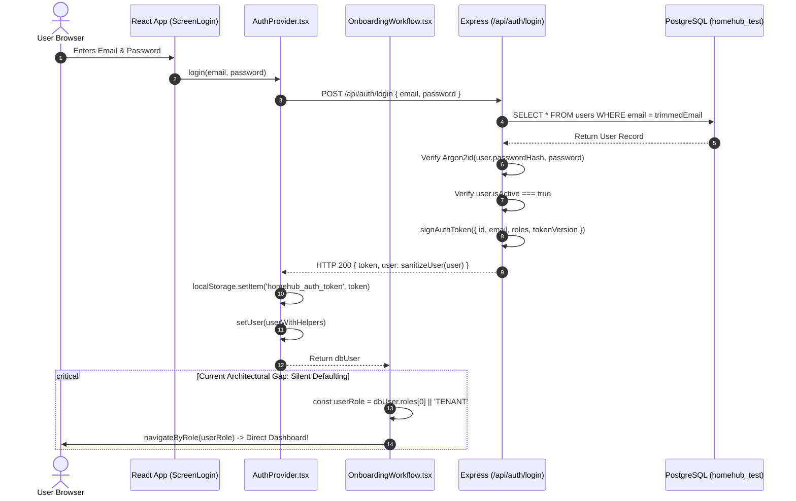

# Authentication & Session Flow Audit

**Package**: `artifacts/homehub-multi-role-account-evidence-2026-10-19/`  
**Date**: 2026-10-19  
**Auditor**: Lead Full-Stack & Systems Engineering Agent  
**Authoritative References**:
- `src/server/routes/auth.ts` (Lines 150–255)
- `src/server/utils/auth.ts` (Lines 1–64)
- `src/server/middleware/auth.ts` (Lines 21–498)
- `src/components/AuthProvider.tsx` (Lines 43–215, 413–433)
- `src/components/onboarding/OnboardingWorkflow.tsx` (Lines 108–170)

---

## 1. Native Authentication Flow (Sign-In)

The current sign-in sequence executes through the following path:



### Trace of Critical Flaws in Current Login
1. **Silent Defaulting to Index 0**:
   - In `src/components/onboarding/OnboardingWorkflow.tsx:167-170`:
     ```typescript
     const dbUser = await auth.login(email, pass);
     const userRole = (dbUser?.roles && dbUser.roles[0]) || 'TENANT';
     navigateByRole(userRole);
     ```
   - **Flaw**: If an account holds both `['PROPERTY_OWNER', 'TENANT']`, the system blindly navigates to `/owner` without presenting any role prompt!
   - This directly violates the product mandate: *"If multiple roles are available, ask the user to choose. Never silently enter a different role."*
2. **Missing Active Role in Backend Session**:
   - The JWT token payload (`src/server/utils/auth.ts:4-10`) is:
     ```typescript
     export interface AuthTokenPayload {
       id: string;
       email: string;
       roles: string[];
       tokenVersion?: number;
       organizationId?: string;
     }
     ```
   - Notice that `activeRole` is **completely absent** from the JWT claims and the database `users` table.

---

## 2. Session Validation & Middleware Enforcement

On every incoming HTTP request to protected endpoints, `requireAuth` (`src/server/middleware/auth.ts:424-465`) executes:

1. **JWT Verification**:
   - Reads `Authorization: Bearer <token>`.
   - Decodes token using HMAC-SHA256 with `JWT_SECRET`.
2. **Authoritative Relational User Lookup**:
   - Executes live database query:
     ```typescript
     const dbUsers = await db.select().from(users).where(eq(users.id, decoded.id)).limit(1);
     ```
   - Verifies user exists and `user.isActive === true`.
3. **Server-Side Token Version Check**:
   - Compares token claims against the database:
     ```typescript
     const currentDbVersion = req.user.tokenVersion ?? 1;
     const tokenVersion = decoded.tokenVersion ?? 1;
     if (tokenVersion !== currentDbVersion) {
       return res.status(401).json({
         error: 'TOKEN_REVOKED',
         message: 'Unauthorized: Session has been invalidated or expired. Please sign in again.',
       });
     }
     ```
   - This prevents stale or stolen tokens from being used after logout or password reset.
4. **Organization Membership Binding**:
   - If `organizationId` is not in token, it dynamically queries `organization_members` for an `ACTIVE` company membership.

---

## 3. Session Revocation & Logout Mechanics

The logout sequence (`src/server/routes/auth.ts:233-255` & `src/components/AuthProvider.tsx:413-433`) is implemented as follows:

1. **Client Dispatches Request**:
   - Client calls `POST /api/auth/logout` with current Bearer token.
2. **Server Atomic Invalidation**:
   - Server decodes token to obtain user ID and executes:
     ```typescript
     await db.update(users)
       .set({ tokenVersion: sql`COALESCE(token_version, 1) + 1` })
       .where(eq(users.id, decoded.id));
     ```
   - This immediately invalidates **all** active tokens for this user across all browsers, tabs, and devices.
3. **Client State Clearance**:
   - In `AuthProvider.tsx:425-432`:
     ```typescript
     localStorage.removeItem('homehub_auth_persona');
     localStorage.removeItem('homehub_auth_token');
     localStorage.removeItem('auth_token');
     setUser(null);
     setToken(null);
     ```

---

## 4. Multi-Tab & Concurrent Session Behavior

1. **Logout in Tab A, Action in Tab B**:
   - When Tab A logs out, `token_version` in PostgreSQL is bumped by 1.
   - Any subsequent request from Tab B presents the pre-logout token.
   - Server compares `tokenVersion` (e.g. 1) against DB `token_version` (2) and immediately returns HTTP 401 `TOKEN_REVOKED`.
   - This behavior is **VERIFIED** by test `NAT-AUTH-23` in `tests/native-auth-security.test.ts`.
2. **Account Switching on Same Browser**:
   - When User 1 logs out, `localStorage` tokens are deleted.
   - When User 2 logs in, new session token and user profile are written to `localStorage`.
   - Because `users.id` and `tokenVersion` change, there is zero session blending at the server level.
   - **Residual Client Risk**: If client components cache role-specific data in React state or unmanaged storage keys, they must be cleanly unmounted on logout.

---

## 5. Active Role Forgery Analysis

Can an attacker or rogue client forge an active role?

1. **Client Role Spoofing**:
   - If a client modifies `localStorage` or injects `{ role: 'PROPERTY_OWNER' }` into client state:
   - Does this give them access to an unauthorized property?
   - **NO**. The server **never trusts client role headers or client state**.
   - Representative route `GET /api/properties/:id` and all mutating routes call `requirePropertyPermission` (`src/server/middleware/auth.ts:514-697`).
   - `requirePropertyPermission` queries PostgreSQL tables `ownership_records`, `management_agreements`, `lease_tenants`, `agent_property_assignments`, and `work_orders`.
   - Unless an authoritative database record exists linking `req.user.id` to the requested resource, access is unconditionally denied with HTTP 403 `AUTHORITY_REQUIRED`.
2. **Missing Active Role Context Guard**:
   - While resource access is secure, the server **does not currently check if the user is in the correct working context**.
   - Example: A user who is both an Owner and a Tenant can call Tenant endpoints while in their Owner dashboard session, and vice-versa.
   - To achieve the product vision, a dedicated `requireActiveRole(role)` middleware must be introduced to cleanly isolate operational workspace sessions.
