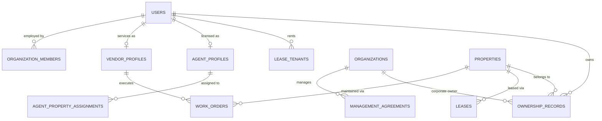

# Identity & Role Architecture Audit

**Package**: `artifacts/homehub-multi-role-account-evidence-2026-10-19/`  
**Date**: 2026-10-19  
**Auditor**: Lead Full-Stack & Systems Engineering Agent  
**Authoritative References**:
- `src/db/schema.ts` (Lines 7–70, 117–165, 270–306, 776–835, 949–1035)
- `src/types/index.ts` (Lines 7–27, 231–238)
- `src/server/routes/auth.ts` (Lines 32–145, 149–228)
- `src/server/middleware/auth.ts` (Lines 424–679)

---

## 1. Identity Foundation & User Table Model

In the HomeHub architecture, identity is centered in the PostgreSQL relational schema (`src/db/schema.ts:7-23`):

```typescript
export const users = pgTable('users', {
  id: text('id').primaryKey().default(sql`gen_random_uuid()`),
  uid: text('uid').unique(), // External IdP mapping (optional)
  firstName: text('first_name').notNull(),
  lastName: text('last_name').notNull(),
  email: text('email').notNull().unique(),
  phone: text('phone'),
  avatarUrl: text('avatar_url'),
  isActive: boolean('is_active').default(true),
  roles: jsonb('roles').$type<string[]>(),
  passwordHash: text('password_hash'),
  failedLoginAttempts: integer('failed_login_attempts').default(0),
  lockedUntil: timestamp('locked_until'),
  tokenVersion: integer('token_version').default(1),
  createdAt: timestamp('created_at').defaultNow(),
  updatedAt: timestamp('updated_at').defaultNow(),
});
```

### Key Architectural Invariants
1. **Email Uniqueness (`users.email`)**:
   - The `email` column possesses a strict SQL `unique()` constraint.
   - Every physical person is identified by a single email address.
2. **Roles Storage (`users.roles`)**:
   - Roles are stored as a PostgreSQL `jsonb` array of strings: `roles: jsonb('roles').$type<string[]>()`.
   - The TypeScript interface `User` in `src/types/index.ts:234` explicitly defines:
     ```typescript
     roles: UserRole[]; // Users can have multiple roles (e.g. Owner AND Buyer)
     ```
   - Technically, PostgreSQL and Drizzle can effortlessly store multiple roles for a single user row, e.g., `['PROPERTY_OWNER', 'TENANT']` or `['PROPERTY_OWNER', 'TENANT', 'AGENT', 'VENDOR']`.

---

## 2. Why Multi-Role Registration Currently Fails

Despite the database schema supporting a JSONB array of multiple roles, the **current registration implementation (`src/server/routes/auth.ts:32-145`) prevents multi-role accounts**:

1. **Single Role Assignment on Registration**:
   - When a user registers via `POST /api/auth/register`, the payload accepts a single `role` or `accountType`.
   - Line 92 initializes the user row with:
     ```typescript
     roles: [roleToAssign]
     ```
2. **Duplicate Email Rejection (Fail-Closed)**:
   - Lines 79–82 perform an explicit pre-check:
     ```typescript
     const existing = await tx.select().from(users).where(eq(users.email, trimmedEmail)).limit(1);
     if (existing.length > 0) {
       return { duplicate: true };
     }
     ```
   - Line 127 halts the request with HTTP 409:
     ```json
     { "error": "EMAIL_ALREADY_EXISTS", "message": "This email is already registered." }
     ```
3. **No Existing Role-Addition API**:
   - There is currently **zero endpoint** (such as `POST /api/auth/roles/add` or `POST /api/user/roles`) for an authenticated user to attach an additional role to their existing identity.
   - An existing Property Owner wishing to become a Tenant or Vendor is currently forced to either use a separate email address (violating "One Identity") or fail entirely.

---

## 3. Four-Role Entity & Relationship Model

HomeHub does **NOT** treat the four supported roles as interchangeable cosmetic tags. Operational authority is **strictly relationship-scoped** and validated against distinct domain tables:



### A. Property Owner (`PROPERTY_OWNER`)
- **Governing Table**: `ownership_records` (`src/db/schema.ts:117-126`).
- **Foreign Key**: `ownership_records.ownerId` references `users.id` (or `companyId` references `organizations.id`).
- **Authority Scope**: Property-level. A user is only an owner for properties where a `VERIFIED` or `PENDING_VERIFICATION` record exists in `ownership_records`.
- **Server Guard**: `requirePropertyPermission` Scenario 1 (`src/server/middleware/auth.ts:534-547`) queries `ownership_records` directly using `ownerId = req.user.id`.

### B. Tenant (`TENANT`)
- **Governing Tables**: `leases` and `lease_tenants` (`src/db/schema.ts:143-164`).
- **Foreign Key**: `lease_tenants.tenantId` references `users.id`, with `lease_tenants.leaseId` referencing `leases.id`.
- **Authority Scope**: Unit/Lease-level. A tenant has authority only over the specific property and unit covered by an `ACTIVE` or `EXPIRING` lease.
- **Server Guard**: `requireActiveLease` (`src/server/routes/tenant.ts:30-48`) and `requirePropertyPermission` Scenario 3 (`src/server/middleware/auth.ts:626-642`).

### C. Agent / Broker (`AGENT` / `AGENT_BROKER`)
- **Governing Tables**:
  * Profile: `agent_profiles` (`src/db/schema.ts:776-797`, unique `userId`).
  * Licensing: `agent_licenses` (`verificationStatus = 'APPROVED'`).
  * Assignment: `agent_property_assignments` (`status = 'ACTIVE'`, `expiryDate > NOW()`, `permissions` array).
- **Foreign Key**: `agent_property_assignments.userId` references `users.id`.
- **Authority Scope**: Explicit assignment-level. An agent can ONLY view or manage properties explicitly assigned by the owner or management company via `agent_property_assignments`.
- **Server Guard**: `requirePropertyPermission` Scenario 4 (`src/server/middleware/auth.ts:644-660`) and `agentRepository.getAssignedProperties` (`src/server/repositories/agent.ts:1273-1285`).

### D. Vendor / Service Provider (`VENDOR`)
- **Governing Tables**:
  * Profile: `vendor_profiles` (`src/db/schema.ts:949-971`, unique `userId`).
  * Licensing: `vendor_licenses` (`status = 'APPROVED'`).
  * Work Orders: `work_orders` (`src/db/schema.ts:301-322`, `vendorUserId` references `users.id`).
  * Maintenance Quotes: `maintenance_quotes` (`vendorUserId` references `users.id`).
- **Foreign Key**: `work_orders.vendorUserId` references `users.id`.
- **Authority Scope**: Job/Work-order-level. A vendor has zero access to general property records or owner financials. They only access properties where an active work order (`ASSIGNED`, `SCHEDULED`, `IN_PROGRESS`) is assigned to them.
- **Server Guard**: `requirePropertyPermission` Scenario 5 (`src/server/middleware/auth.ts:662-677`) and `vendorRepository.getWorkOrders` (`src/server/repositories/vendor.ts:297-304`).

---

## 4. Multi-Role Coexistence Analysis

Can one identity hold all four roles simultaneously?

| Combination | Schema Compatibility | Relational Feasibility | Authorization Feasibility |
| :--- | :---: | :---: | :---: |
| **Owner + Tenant** | ✅ Fully Compatible | ✅ `ownership_records` and `lease_tenants` can both link to `users.id` | ✅ `requirePropertyPermission` handles owner checks on Prop A and tenant checks on Prop B |
| **Owner + Agent** | ✅ Fully Compatible | ✅ `ownership_records` and `agent_profiles` coexist on `users.id` | ✅ Agent assignment guards prevent agent from claiming ownership over unassigned properties |
| **Tenant + Vendor** | ✅ Fully Compatible | ✅ `lease_tenants` and `vendor_profiles` coexist on `users.id` | ✅ Vendor work orders strictly isolated from tenant rent schedules |
| **All 4 Roles** | ✅ Fully Compatible | ✅ `users.id` can reference all 4 domain tables without SQL collision | ✅ Each domain route independently validates DB relationships |

### Unique Constraints Audit:
1. `users.email UNIQUE`: Allows 1 user identity per email (desirable).
2. `agent_profiles.userId UNIQUE`: Allows 1 agent profile per user (desirable).
3. `vendor_profiles.userId UNIQUE`: Allows 1 vendor profile per user (desirable).
4. `ownership_records`: No unique constraint on `ownerId` (a user can own multiple properties).
5. `lease_tenants`: No unique constraint on `tenantId` (a user can rent multiple properties).

**Conclusion**: The database schema is **100% physically capable of multi-role coexistence** without schema alterations. The blockage is entirely located in the application-tier registration endpoint and the login redirect handler.

---

## 5. Role Revocation, Suspension, and Expiration

HomeHub enforces multi-tiered authority revocation:

1. **Global Account Suspension**:
   - Handled via `users.isActive = false`.
   - Enforced at login (`src/server/routes/auth.ts:201-203`) with HTTP 403 `ACCOUNT_SUSPENDED`.
   - Enforced on all authenticated routes (`src/server/middleware/auth.ts:448-450`) with HTTP 403 `Forbidden: Account suspended`.
2. **Domain-Specific Role Suspension**:
   - `agent_profiles.status`: `ACTIVE`, `INACTIVE`, `SUSPENDED`, `PENDING_VERIFICATION`.
   - `vendor_profiles.status`: `ACTIVE`, `INACTIVE`, `SUSPENDED`, `PENDING_VERIFICATION`.
   - `organization_members.status`: `ACTIVE`, `SUSPENDED`, `REMOVED`.
3. **Temporal Expiration**:
   - `agent_property_assignments.expiryDate`: Checked dynamically against `new Date()`.
   - `leases.endDate`: Handled via lease lifecycle state transitions (`ACTIVE` $\rightarrow$ `EXPIRING` $\rightarrow$ `EXPIRED`).
   - `management_agreements.endDate`: Checked dynamically during permission resolution.
4. **Immediate Session Invalidation**:
   - `users.token_version`: Incremented atomically in PostgreSQL on logout and password reset.
   - Any token presented with an obsolete `tokenVersion` is rejected immediately with HTTP 401 `TOKEN_REVOKED`.
