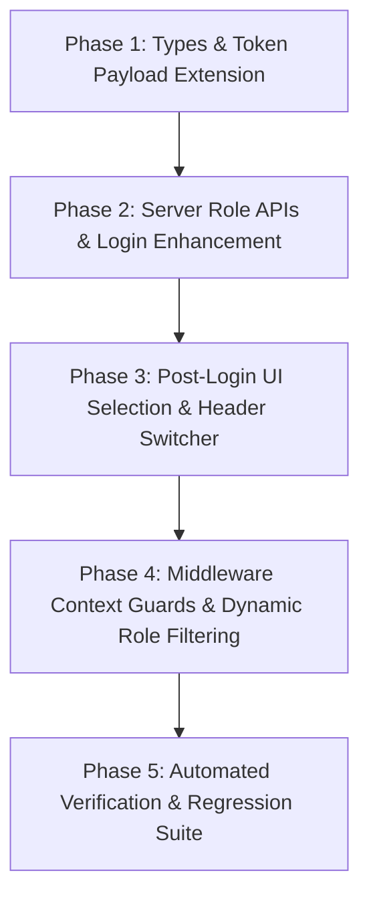

# Proposed Implementation Plan — Multi-Role Accounts

**Package**: `artifacts/homehub-multi-role-account-evidence-2026-10-19/`  
**Date**: 2026-10-19  
**Auditor**: Lead Full-Stack & Systems Engineering Agent  
**Constraint**: Minimal Safe Footprint, Zero Disruption to Existing Rental Workflows, Rental-Only Scope.

---

## 1. Architectural Strategy

The proposed implementation resolves the conflict between "One Identity" and "Explicit Role Choice" through a clean 4-phase rollout:

1. **Non-Breaking Database & Session Enhancement**:
   - Utilize existing `users.roles` JSONB array for persistent role holdings.
   - Introduce `activeRole` in the session context (JWT payload and client auth context).
2. **Authoritative Server APIs**:
   - Enhance `POST /api/auth/login` to evaluate the count of eligible (non-suspended) roles.
   - Add `POST /api/auth/roles/enroll` to allow existing users to adopt an additional role without creating duplicate identities or hitting email uniqueness conflicts.
   - Add `POST /api/auth/roles/switch` to authoritatively validate that the user holds the target role before switching context.
3. **Explicit Client Role Selection & Switcher**:
   - If exactly 1 role is eligible, directly enter the dashboard.
   - If $> 1$ roles are eligible, present `ScreenSelectActiveRole` after every fresh sign-in.
   - Provide a persistent navigation Role Switcher in the dashboard header.
4. **Context-Aware Fail-Closed Guards**:
   - Retain all existing relational resource checks (`requirePropertyPermission`, `ownership_records`, `lease_tenants`, `work_orders`).
   - Add `requireActiveRole(role)` to prevent cross-workspace confusion while maintaining fail-closed database isolation.

---

## 2. Phase-by-Phase Dependency Roadmap



### Phase 1: Types & Session Claims Foundation
- **Target Files**:
  * `src/types/index.ts`
  * `src/server/utils/auth.ts`
  * `src/types/auth.ts` (if applicable)
- **Changes**:
  1. Add `activeRole?: string` and `eligibleRoles?: string[]` to `AuthTokenPayload`.
  2. Extend `AuthUser` in `src/components/AuthProvider.tsx` to include `activeRole: string | null` and `eligibleRoles: string[]`.
- **Invariants**: Non-breaking change; existing tokens continue to decode gracefully.

### Phase 2: Server-Side Authentication & Role Lifecycle APIs
- **Target Files**:
  * `src/server/routes/auth.ts`
  * `src/server/repositories/user.ts` (or direct Drizzle helper)
- **Changes**:
  1. **Update `POST /api/auth/login`**:
     - Query user's held roles from `users.roles`.
     - Filter out roles whose backing domain status is suspended (e.g. check if `agent_profiles.status === 'SUSPENDED'` or `vendor_profiles.status === 'SUSPENDED'`).
     - If filtered roles count === 1, set `activeRole = roles[0]` and `requiresRoleSelection = false`.
     - If filtered roles count > 1, set `requiresRoleSelection = true` and `activeRole = null`.
     - Return `{ token, user, requiresRoleSelection, eligibleRoles }`.
  2. **Add `POST /api/auth/roles/enroll` (Protected by `requireAuth`)**:
     - Body: `{ role: 'OWNER' | 'TENANT' | 'AGENT' | 'VENDOR', entityType?: 'INDIVIDUAL' | 'COMPANY', companyName?: string }`.
     - Checks if role is already in `users.roles`. If not, appends it atomically in a PostgreSQL transaction:
       ```typescript
       await tx.update(users)
         .set({ roles: sql`array_to_json(array_append(ARRAY(SELECT jsonb_array_elements_text(roles)), ${newRole}))::jsonb` })
         .where(eq(users.id, req.user.id));
       ```
     - Provisions corresponding profile record (`agent_profiles` or `vendor_profiles` or company organization member) if required.
     - Logs `ROLE_ENROLLED` in audit log.
  3. **Add `POST /api/auth/roles/switch` (Protected by `requireAuth`)**:
     - Body: `{ targetRole: string }`.
     - Validates that `targetRole` is included in user's held `roles` and is not suspended.
     - Issues a refreshed JWT containing `activeRole: targetRole`.
     - Returns refreshed `{ token, activeRole }`.

### Phase 3: Client Post-Login Selection & Workspace Switcher
- **Target Files**:
  * `src/components/AuthProvider.tsx`
  * `src/components/onboarding/OnboardingWorkflow.tsx`
  * `src/components/onboarding/ScreenSelectActiveRole.tsx` (New component)
  * `src/components/navigation/RoleSwitcherDropdown.tsx` (New or integrated into headers)
- **Changes**:
  1. In `OnboardingWorkflow.tsx`:
     - Inspect `requiresRoleSelection` from login response.
     - If `requiresRoleSelection === true`, set step to `'select_active_role'`.
     - Render `ScreenSelectActiveRole` showing only the user's `eligibleRoles`.
     - On selection, call `switchRole(chosenRole)` and navigate to `getDestinationForRole(chosenRole)`.
     - If `requiresRoleSelection === false`, navigate directly to `getDestinationForRole(activeRole)`.
  2. In Dashboard Top Navigation:
     - Render a sleek Role Switcher badge showing current active role with a dropdown of other held roles.
     - Switching role calls `auth.switchRole(newRole)` and smoothly navigates to the respective workspace.

### Phase 4: Context Guard & Failure Protection
- **Target Files**:
  * `src/server/middleware/auth.ts`
- **Changes**:
  1. Add `requireActiveRole(expectedRole: UserRole | string)`:
     - Validates that `req.user.activeRole === expectedRole` (or Platform Admin override).
     - Returns HTTP 403 `INCORRECT_ACTIVE_ROLE_CONTEXT` with helpful remediation `{ currentActiveRole, requiredRole }`.
  2. Retain all underlying `requirePropertyPermission` relational checks.

### Phase 5: Verification & Regression Harness
- **Target Files**:
  * `tests/multi-role-account-integrity.test.ts` (New test suite)
- **Coverage**:
  1. Single Owner -> direct `/owner`.
  2. Single Tenant -> direct `/tenant`.
  3. Owner + Tenant -> returns `requiresRoleSelection: true`; selecting Tenant enters `/tenant`; selecting Owner enters `/owner`.
  4. Enrolling new role to existing account -> succeeds with 200, adds to roles, zero duplicate email error.
  5. Suspended Agent role -> omitted from eligible choices.
  6. Tampered active role header -> server authorization rejects unauthorized property access.

---

## 3. Rollback & Fail-Safe Considerations

1. **Zero Irreversible Schema Mutations**:
   - `users.roles` is already a JSONB array. No table drop or destructive column rewrite is needed.
   - If rollback is necessary, reverting `OnboardingWorkflow.tsx` to `dbUser.roles[0]` immediately restores legacy behavior.
2. **Backward Compatibility for Single-Role Users**:
   - Existing single-role users experience zero change in UX: they sign in and immediately land on their dashboard without encountering any additional screens.
3. **Session Fail-Closed Invariant**:
   - If an invalid or unheld role is supplied in a switch request, the server rejects it and maintains the existing session without invalidating credentials.
